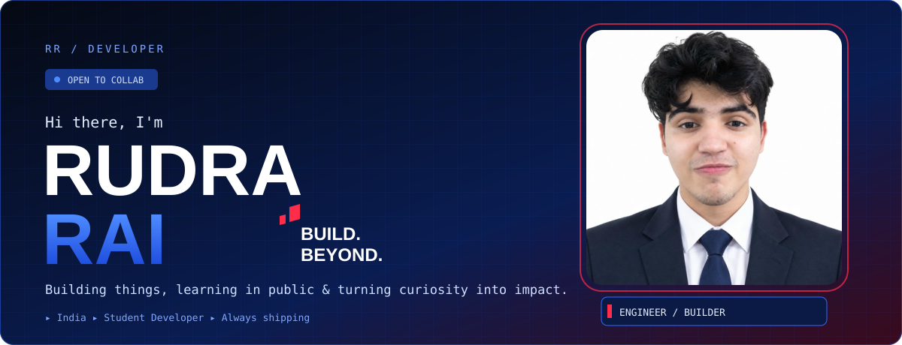
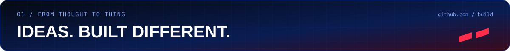
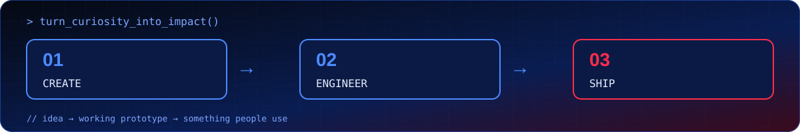
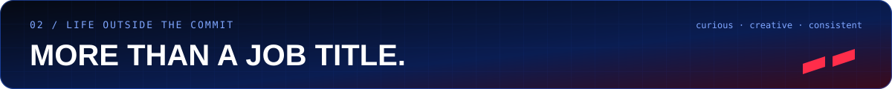
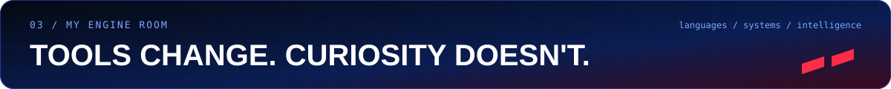
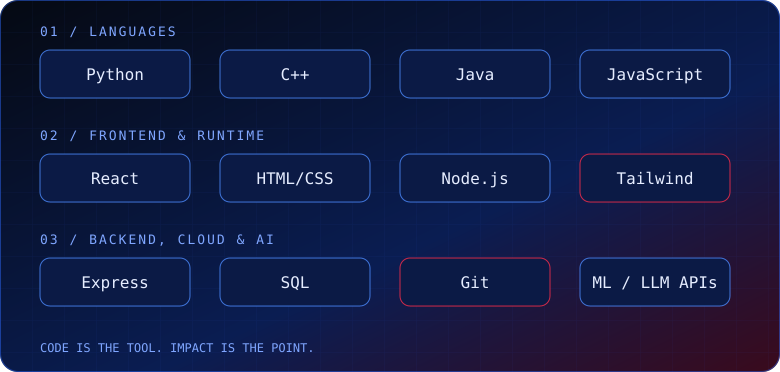
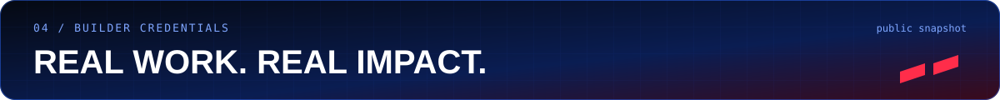
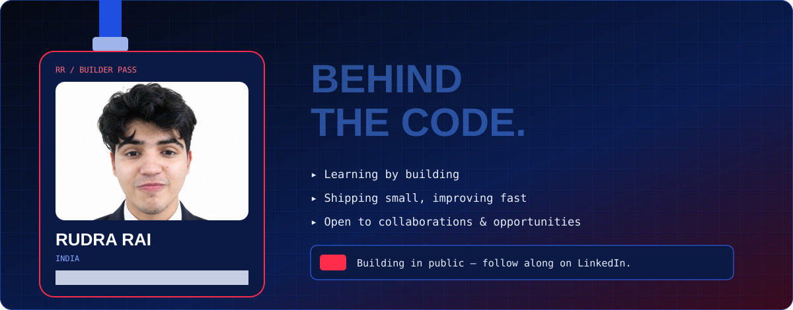
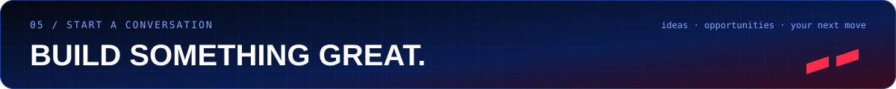

I like turning a rough idea into something that actually works — then making it better. I learn by building, ship in small steps, and enjoy solving real problems with code.

- 🔭 Currently exploring: *add what you're learning*
- 🛠️ Currently building: *add your current project*
- 🤝 Open to: collaborations, internships & interesting conversations
- ⚡ Fun fact: *add something about you*

### Things I've built

| Project | What it does | Focus |
|---|---|---|
| [Project One](https://github.com/YOUR_USERNAME/project-one) | One-line description | Web |
| [Project Two](https://github.com/YOUR_USERNAME/project-two) | One-line description | AI / ML |
| [Project Three](https://github.com/YOUR_USERNAME/project-three) | One-line description | Tools |

### Let's connect

**LinkedIn:** [linkedin.com/in/rudra-rai-99011b270](https://www.linkedin.com/in/rudra-rai-99011b270/)

